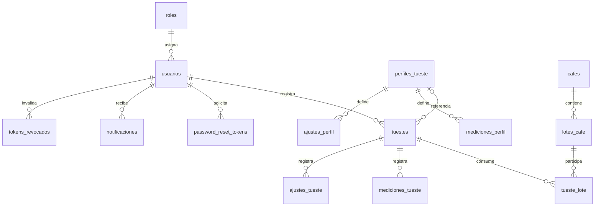

# RoastLab

**RoastLab** es una aplicación web full stack para administrar el proceso de tostado de café. Permite mantener el catálogo de cafés y lotes verdes, crear perfiles con curvas de referencia, registrar tuestes con temperatura y ajustes de máquina, y consultar historial y reportes. El acceso y las operaciones disponibles dependen del rol del usuario.

## Enlaces del proyecto

| Recurso | Enlace |
|---|---|
| Aplicación publicada con HTTPS | [https://roastlab.space](https://roastlab.space) |
| URL base de la API | `https://roastlab.space/api` |
| Repositorio público | [BriCortesTec/RoastLab_Final](https://github.com/BriCortesTec/RoastLab_Final) |
| Tablero de GitHub Projects | [RoastLab — tablero de trabajo](https://github.com/users/BriCortesTec/projects/2/views/1) |
| Prototipo navegable de Figma | [Diseño de RoastLab](https://www.figma.com/proto/1egifmObbzIeqee7HPtVCb/RoastLab?node-id=5-15&p=f&m=draw&scaling=min-zoom&content-scaling=fixed&page-id=0%3A1&starting-point-node-id=5%3A15) |

### Equipo

- **Nadya Yahuilí Avendaño Chávez** — frontend y diseño.
- **López Cortés Hayley Brithany** — backend y despliegue.


> Completar los campos entre corchetes antes de entregar. El historial público de GitHub debe reflejar las contribuciones reales de ambas personas.

## Problema y solución

El tueste requiere registrar lecturas, hitos y cambios de máquina para poder analizar y repetir procesos. RoastLab organiza esa información en perfiles de referencia y tuestes reales vinculados a cafés y lotes. El sistema guarda quién registró cada tueste y aplica permisos según el usuario autenticado.

## Funcionalidades

- Inicio de sesión con correo, contraseña y JWT.
- Gestión de usuarios y permisos por rol.
- Catálogo de cafés y lotes de café verde.
- Creación, consulta y edición de perfiles con curvas de referencia.
- Registro de tuestes con cronómetro, lecturas de temperatura, hitos y ajustes de máquina.
- Consulta de curvas guardadas, historial y reportes.
- Filtros y paginación ejecutados por la API.
- Notificaciones y bitácora de envíos.

## Tecnologías

| Capa | Tecnologías |
|---|---|
| Frontend | React 18, Vite, Axios, CSS |
| Backend | Java 21, Spring Boot, Spring Security, JWT, Spring Data JPA/Hibernate, Bean Validation |
| Base de datos | MySQL 8 |
| Versionado de esquema | Flyway |
| Correo | JavaMailSender y Postfix en el VPS |
| WhatsApp | Meta WhatsApp Cloud API |
| Pruebas de API | Bruno |
| Servidor | VPS Ubuntu, systemd, Nginx y Certbot/Let's Encrypt |

Los avisos automáticos por SMS están temporalmente desactivados en esta entrega. WhatsApp requiere credenciales vigentes de Meta y la plantilla aprobada correspondiente. La configuración de producción se guarda en el servidor, fuera del repositorio.

## Usuarios, roles y credenciales de evaluación

El correo es el identificador de acceso. Las contraseñas deben tener al menos 8 caracteres, una mayúscula, un número y un carácter especial. El frontend muestra errores junto a los campos y el backend valida los datos de nuevo mediante Bean Validation.

| Rol | Permisos principales |
|---|---|
| **Administración** | Acceso global, gestión de usuarios y administración de los módulos. |
| **Gerencia** | Gestión de cafés, lotes y perfiles; consulta tuestes e informes; puede crear tostadores. No registra tuestes. |
| **Tostador** | Consulta cafés, lotes y perfiles; registra tuestes y consulta sus propios registros. |

Spring Security protege los endpoints; el frontend restringe rutas y acciones según el rol, pero la autorización efectiva se valida en el backend.

### Primer administrador

Flyway crea las tablas y los roles, pero no crea una cuenta administrativa con una contraseña universal. Para crear el primer administrador, el equipo ejecuta `backend/deploy/crear-admin.py` después de iniciar la base de datos. El script pide el correo y la contraseña de forma interactiva, aplica las reglas de contraseña y guarda el hash con BCrypt. Si ya hay un administrador, no crea otro.

La guía del [despliegue en VPS](backend/deploy/DEPLOY.md) describe la ejecución del script. Administración puede crear después las cuentas de gerencia y tostadores.

**Credenciales de la cuenta de evaluación** (completar con una cuenta dedicada; no usar credenciales de producción):

- Correo: `[correo de evaluación]`
- Contraseña: `[contraseña de evaluación]`
- Rol: `administración`

## Arquitectura del repositorio

```text
RoastLab_Final/
├── backend/       API Spring Boot, servicios, seguridad, migraciones y despliegue
├── frontend/      Aplicación React/Vite
├── database/      Modelo de MySQL Workbench y SQL de ejemplo
└── README.md      Documentación general
```

El frontend consume la API REST bajo `/api`. En desarrollo se configura mediante `VITE_API_URL`. Las peticiones protegidas envían `Authorization: Bearer <token>`.

## Diagrama entidad-relación



La relación muchos a muchos se da entre `tuestes` y `lotes_cafe`, mediante la tabla de unión `tueste_lote`. El archivo editable de MySQL Workbench es [`database/RoastLab.mwb`](database/RoastLab.mwb).

### Entidades principales

`roles`, `usuarios`, `cafes`, `lotes_cafe`, `perfiles_tueste`, `mediciones_perfil`, `ajustes_perfil`, `tuestes`, `mediciones_tueste`, `ajustes_tueste`, `tueste_lote`, `password_reset_tokens`, `tokens_revocados` y `notificaciones`.

## Base de datos, migraciones y datos de muestra

La aplicación usa MySQL 8. Flyway versiona el esquema en `backend/src/main/resources/db/migration/`. Hibernate usa `ddl-auto=validate`; no se depende de `ddl-auto=create` para crear tablas.

| Migración | Contenido |
|---|---|
| V1–V4 | Esquema inicial, mediciones, normalización de cafés/lotes y perfiles/ajustes. |
| V5 | Roles de administración, gerencia y tostador. |
| V6 | Teléfono, revocación de JWT, recuperación de contraseña y bitácora de notificaciones. |
| V7 | Datos de referencia para perfiles de tueste. |
| V8 | Lote de referencia en los perfiles. |

`database/RoastLab_schema.sql` es un SQL de ejemplo separado de Flyway; no es una copia de seguridad de la base desplegada. Sus datos no se importan automáticamente al arrancar el backend. **La carga automática y la cantidad mínima de 10–15 registros por cada tabla principal deben verificarse/completarse antes de la evaluación si se exige que la instancia limpia tenga esos datos.** No ejecutar ese archivo sobre producción sin revisar primero su contenido.

## Ejecutar en local

### Requisitos

- Git.
- Java 21.
- Node.js 20 o superior y npm.
- MySQL 8.
- Bruno, para ejecutar las pruebas de API.

### 1. Clonar y crear la base

```bash
git clone https://github.com/BriCortesTec/RoastLab_Final.git
cd RoastLab_Final
```

En MySQL:

```sql
CREATE DATABASE roastlab_final
  CHARACTER SET utf8mb4
  COLLATE utf8mb4_unicode_ci;
```

### 2. Configurar y ejecutar el backend

Copia `backend/src/main/resources/application.properties.example` como `application-local.properties` en esa misma carpeta. Define usuario y contraseña locales de MySQL y un secreto aleatorio para `app.jwt.secret`. No guardes credenciales reales en Git.

Linux/macOS:

```bash
cd backend
./mvnw spring-boot:run
```

Windows PowerShell:

```powershell
cd backend
.\mvnw.cmd spring-boot:run
```

El backend queda en `http://localhost:8080/api`. Flyway aplica las migraciones al iniciar.

### 3. Configurar y ejecutar el frontend

En una segunda terminal:

```bash
cd frontend
npm ci
```

Copia `frontend/.env.example` como `frontend/.env` y verifica que contenga:

```env
VITE_API_URL=http://localhost:8080/api
```

Inicia Vite:

```bash
npm run dev
```

Abre la dirección que indique la terminal, normalmente `http://localhost:5173`. Mantén abiertas las terminales de frontend y backend durante la prueba. Para detener un proceso, presiona `Ctrl+C` en su terminal.

### Compilación del frontend

```bash
cd frontend
npm run build
```

Vite genera los recursos estáticos en `frontend/dist/`.

## API REST

- **Producción:** `https://roastlab.space/api`
- **Desarrollo local:** `http://localhost:8080/api`

Los recursos cubren autenticación, usuarios, cafés, lotes, perfiles, tuestes, reportes y notificaciones. Las rutas, métodos y cuerpos exactos están definidos en los controladores y documentados en la colección Bruno `backend/bruno/RoastLab/`.

Las rutas privadas requieren el JWT en `Authorization: Bearer <token>`. Los listados aceptan filtros y parámetros de paginación en el servidor (`page`, `size`, búsqueda y filtros del recurso). Las respuestas paginadas incluyen contenido y metadatos de páginas. Los errores se responden como JSON con el estado HTTP apropiado; los errores de validación incluyen información de los campos cuando corresponde.

## Validaciones y experiencia de interfaz

- Los DTO de entrada del backend validan campos con Bean Validation y `@Valid`; el controlador no es el lugar donde se duplican las reglas de negocio.
- El frontend muestra los errores bajo el campo correspondiente y puede hacer validaciones inmediatas para guiar al usuario antes de llamar a la API.
- Los fallos de red y de autorización se presentan en la interfaz.
- Las acciones importantes o destructivas usan diálogos de confirmación propios; no se deben usar `alert()` ni `window.confirm()` nativos.
- La interfaz adapta sus pantallas a escritorio y móvil; los listados se consultan paginados desde el backend.

## Pruebas de API con Bruno

La colección está versionada en `backend/bruno/RoastLab/` e incluye entornos `local` y `produccion`, login y obtención de JWT, solicitudes protegidas y casos de error (credenciales inválidas, falta de token, validación, recurso inexistente y permisos). En Bruno:

1. Abre la carpeta `backend/bruno/RoastLab/`.
2. Selecciona el entorno correspondiente.
3. Ejecuta primero una solicitud de login para generar el token.
4. Ejecuta las solicitudes protegidas y casos de error.

**Registra aquí la fecha y resultado de la última ejecución de la colección antes de entregar:** `[pendiente de completar]`.

## Comunicación con el usuario

| Canal | Implementación/estado |
|---|---|
| Correo | JavaMailSender entrega mediante Postfix local del VPS. La guía incluye Postfix y los registros SPF, DKIM y DMARC. Debe probarse la entrega real a una bandeja externa. |
| WhatsApp | Meta WhatsApp Cloud API. Requiere credenciales del número, token y plantilla aprobada; completar una prueba de entrega desde la aplicación con el número autorizado. |
| SMS | Desactivado temporalmente en esta entrega; por tanto, ese requisito de la rúbrica sigue pendiente. |

La configuración de mensajería se realiza con secretos en el VPS; nunca se deben incluir tokens reales en GitHub.

## Diseño en Figma

El [prototipo de Figma](https://www.figma.com/proto/1egifmObbzIeqee7HPtVCb/RoastLab?node-id=5-15&p=f&m=draw&scaling=min-zoom&content-scaling=fixed&page-id=0%3A1&starting-point-node-id=5%3A15) contiene las pantallas del sistema. La identidad usa tonos verdes oscuros, crema y dorados para relacionar el producto con el café, la naturaleza y el tostado. Antes de entregar, confirmar que el prototipo siga siendo navegable, que incluya pantallas de los tres roles y que el logo final sea el original del equipo.

## Despliegue en VPS

La aplicación está publicada en `https://roastlab.space`. El despliegue objetivo mantiene MySQL y el JAR de Spring Boot en Ubuntu; systemd administra el backend y Nginx sirve el build de React con HTTPS de Let's Encrypt/Certbot. La guía paso a paso y scripts están en [`backend/deploy/DEPLOY.md`](backend/deploy/DEPLOY.md) y `backend/deploy/`.

Comprobaciones operativas desde el VPS:

```bash
sudo systemctl status roastlab nginx mysql postfix
curl -i https://roastlab.space/api/cafes
```

La segunda solicitud debe responder con el comportamiento protegido definido por el backend (por ejemplo, `401` si no se envía un token). Verificar el candado HTTPS en navegador y probar el inicio de sesión con la cuenta de evaluación.

## Seguridad

- Las contraseñas se almacenan con BCrypt.
- Los JWT se envían por encabezado y se invalidan al cerrar sesión.
- Los endpoints aplican autenticación y autorización por rol en Spring Security.
- La recuperación de contraseña utiliza tokens de un solo uso con vencimiento.
- No subir `application-local.properties`, `application-prod.properties`, contraseñas, claves JWT ni credenciales de proveedores.
- Usar `application.properties.example` y `backend/deploy/application-prod.properties.example` como plantillas sin secretos reales.
