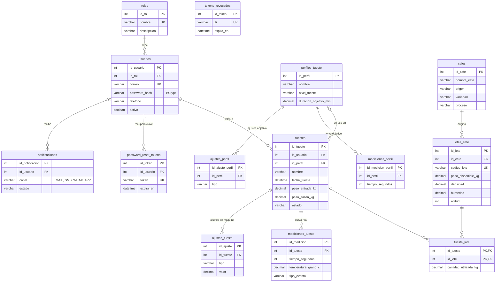

# ☕ RoastLab

Aplicación web full stack para **gestionar tuestes de café**: catálogo de cafés y lotes de café verde, perfiles de tueste con su curva objetivo, registro de tuestes en vivo (temperatura, hitos y ajustes de máquina), historial con curvas, reportes y notificaciones al usuario por correo, SMS y WhatsApp.

| | |
|---|---|
| **Sitio (HTTPS)** | https://roastlab.site |
| **URL base de la API** | https://roastlab.site/api |
| **Repositorio** | https://github.com/BriCortesTec/RoastLab_Final |
| **Tablero GitHub Projects** | https://github.com/users/BriCortesTec/projects/2/views/1 |
| **Prototipo Figma** | _[PEGAR AQUÍ EL LINK DEL PROTOTIPO NAVEGABLE]_ |
| **Equipo** | Equipo _[N.º]_ — _[Nombre completo de Bri]_ (backend y despliegue) · Nadya Yahuilí Avendaño Chávez (frontend) |

## Tecnologías

| Capa | Tecnología |
|---|---|
| Backend | Java 21, Spring Boot 4, Spring Security + JWT (jjwt), Spring Data JPA/Hibernate, Bean Validation, Flyway |
| Frontend | React 18, Vite, Axios |
| Base de datos | MySQL 8 (migraciones con Flyway) |
| Comunicación | Postfix + JavaMailSender (correo), Twilio (SMS y WhatsApp) |
| Pruebas de API | Bruno (carpeta `bruno/` versionada) |
| Despliegue | VPS Ubuntu, systemd, Nginx, Let's Encrypt (Certbot) |

## Usuarios de prueba

Contraseña de **todos** los usuarios de prueba: `RoastLab#2026`

| Rol | Correo | Qué puede hacer |
|---|---|---|
| **Administrador** (credenciales fijas de evaluación) | `admin@roastlab.site` | Todo: gestión de usuarios, CRUD de todos los módulos, bitácora de notificaciones |
| **Gerente** | `gerente@roastlab.site` | CRUD de cafés, lotes y perfiles; consulta de todos los tuestes y reportes |
| **Tostador** (cliente) | `tostador@roastlab.site` | Solo lectura de catálogos; registra y consulta **únicamente sus propios** tuestes |

Hay 12 usuarios en total (1 administrador, 2 gerentes y 9 tostadores). Los registros nuevos creados desde la pantalla de registro son siempre **tostador**.

Requisitos de contraseña (validados en el frontend bajo el input y en el backend con Bean Validation): mínimo 8 caracteres, una mayúscula, un número y un carácter especial.

## Diagrama entidad-relación



La relación **muchos a muchos** es `tuestes ↔ lotes_cafe` mediante `tueste_lote` (un tueste puede mezclar varios lotes y un lote se usa en varios tuestes). Modelo de MySQL Workbench en `database/RoastLab.mwb`.

## Base de datos y migraciones

Las tablas se crean **solo con Flyway** (`backend/src/main/resources/db/migration`), con `spring.jpa.hibernate.ddl-auto=validate`:

| Migración | Contenido |
|---|---|
| V1–V4 | Esquema base, mediciones, normalización de cafés/lotes, perfiles y ajustes |
| V5 | Roles del sistema (`tostador`, `gerencia`, `administración`) |
| V6 | Teléfono de usuario, tokens revocados (logout), recuperación de contraseña y bitácora de notificaciones |
| Datos de muestra | `database/RoastLab_schema.sql` (se ejecuta manualmente; no es una migración Flyway) |

El archivo [`database/RoastLab_schema.sql`](../database/RoastLab_schema.sql) contiene el esquema y datos de muestra. No es un respaldo generado desde una instancia de producción. Las migraciones Flyway instaladas actualmente son V1 a V6; los datos de muestra del SQL no se cargan automáticamente con Flyway.

## Instalación local

Requisitos: Java 21, Node 20+, MySQL 8.

```bash
# 1. Base de datos
mysql -u root -p -e "CREATE DATABASE roastlab_final CHARACTER SET utf8mb4;"

# 2. Configuración del backend (los secretos NO se suben al repositorio)
cd backend/src/main/resources
cp application.properties.example application-local.properties
#    edita application-local.properties: password de MySQL y app.jwt.secret
#    (genera el secreto con:  openssl rand -base64 48)

# 3. Backend (Flyway crea las tablas y los datos de prueba al arrancar)
cd ../../..
./mvnw spring-boot:run            # http://localhost:8080/api

# 4. Frontend
cd ../frontend
cp .env.example .env              # VITE_API_URL=http://localhost:8080/api
npm install
npm run dev                       # http://localhost:5173
```

## API (resumen)

Todas las rutas, excepto login, registro y recuperación de contraseña, requieren `Authorization: Bearer <token>`.

| Recurso | Endpoints | ADMIN | GERENTE | TOSTADOR |
|---|---|:-:|:-:|:-:|
| Auth | `POST /api/auth/login · registro · logout · forgot-password · reset-password`, `GET/PUT /api/auth/me` | ✔ | ✔ | ✔ |
| Usuarios | `GET/POST/PUT/DELETE /api/usuarios` | ✔ | – | – |
| Cafés, lotes, perfiles | `GET/POST/PUT/DELETE /api/cafes · lotes · perfiles` | CRUD | CRUD | lectura |
| Tuestes | `GET/POST/PUT/DELETE /api/tuestes` | todos | lectura de todos | CRUD de los suyos |
| Reportes | `GET /api/reportes/resumen` | ✔ | ✔ | los suyos |
| Notificaciones | `GET /api/notificaciones`, `POST /api/notificaciones/prueba` | ✔ | – | – |

Los listados son **paginados y filtrados en el servidor**: `?search=&page=0&size=8` (tuestes acepta además `status=`; usuarios, `role=`). Respuesta: `{ content, page, size, totalElements, totalPages }`.

Los errores siempre son JSON con el código HTTP correcto (400, 401, 403, 404, 409, 422, 500):
`{ timestamp, status, error, message, path, fieldErrors: { campo: "mensaje" } }`.

## Comunicación con el usuario

| Canal | Cuándo se envía | Cómo |
|---|---|---|
| **Correo** | Registro, recuperación de contraseña y tueste completado | `JavaMailSender` → Postfix local del VPS, con SPF, DKIM y DMARC (`deploy/04-postfix-dkim.sh`) |
| **SMS** | Cuando un tueste pasa a *Completado* (si el usuario tiene teléfono) | API REST de Twilio |
| **WhatsApp** | Cuando un tueste pasa a *Completado* (si el usuario tiene teléfono) | API REST de Twilio (WhatsApp) |

Cada envío queda registrado en la tabla `notificaciones` (consultable por el administrador en `GET /api/notificaciones`).

## Pruebas de API con Bruno

Abre la carpeta [`backend/bruno/RoastLab`](bruno/RoastLab) en Bruno y elige el entorno `local` o `produccion`. Ejecuta primero `01-auth` (los logins guardan los tokens JWT). La colección incluye solicitudes de autenticación, peticiones protegidas y casos de error. Está preparada, pero ejecutar las solicitudes y documentar sus resultados sigue pendiente.

## Despliegue

Guía completa en [`deploy/DEPLOY.md`](deploy/DEPLOY.md): swap, MySQL, backend como JAR con systemd, frontend estático servido por Nginx, HTTPS con Let's Encrypt y Postfix con SPF/DKIM.

## Seguridad

- Contraseñas con **BCrypt**; nunca en texto plano.
- JWT en el header `Authorization`; el logout invalida el token (lista negra por `jti`).
- Secretos (`application-local.properties`, `application-prod.properties`) fuera del repositorio; se incluye `application.properties.example`.
- Validaciones en frontend y backend (Bean Validation en los DTO).
- Un tostador no puede ver ni modificar tuestes de otro usuario (403).
